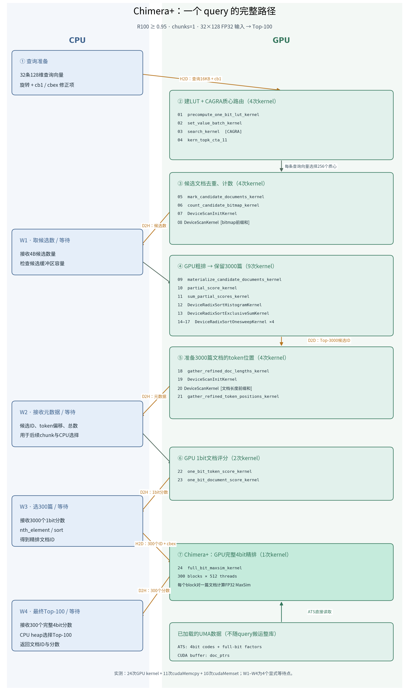
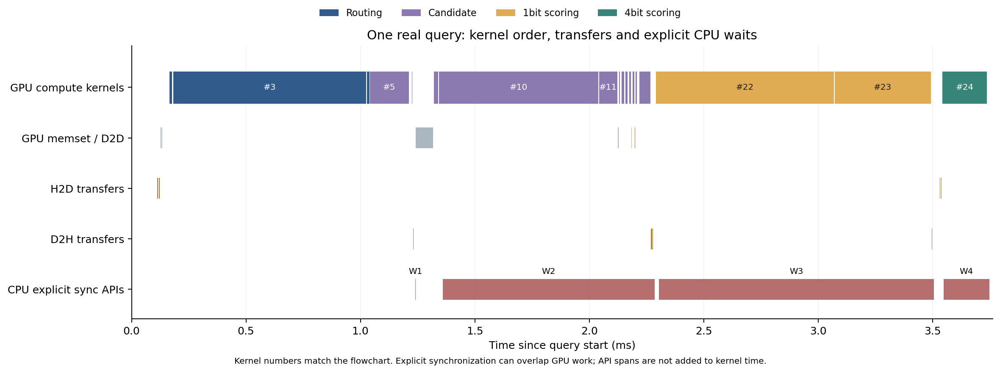

# Chimera+：一个query会触发什么？

**主干：CPU准备查询 → GPU路由/候选粗排 → GPU 1bit评分 → CPU选300篇 → GPU 4bit精排 → CPU返回Top-100。**

以当前LoTTE、R100≥0.95配置的一条真实查询为例：`nprobe256 / refine3000 / full300 / itopk288 / chunks1`，CPU预算20，B1。

## 完整流程图

蓝色为CPU步骤，绿色为GPU，橙色箭头为数据传输；**W1–W4表示CPU必须确认GPU结果可用后才能继续。** 图中编号对应实际kernel调用顺序。

[放大矢量流程图](../report-assets/chimera-plus-query-flow.svg)

## 候选规模怎么收缩？

| 步骤 | 输入 → 输出 |
|---|---|
| CPU查询准备 | 32×128 FP32 → 旋转后的查询与修正项 |
| CAGRA路由 | 每条查询向量 → 256个聚类中心 |
| 候选生成 | 命中的倒排文档 → 去重候选集合，数量随query变化 |
| GPU候选粗排 | 全部候选 → 3000篇文档 |
| GPU 1bit评分 | 3000篇 → 3000个近似MaxSim分数 |
| CPU选择 | 按1bit分数 → 300篇精排文档 |
| GPU完整4bit评分 | 300篇 → 300个完整4bit MaxSim分数 |
| CPU最终排序 | 300个分数 → Top-100文档 |

**Chimera+只替换了最后的完整4bit评分。** 候选选择与最终Top-k仍在CPU，查询也仍在CPU旋转；当前还不是整个流程都留在GPU。

## 实际执行时间轴

下面是同一条查询的实测轨迹，横轴为毫秒。GPU行上的编号对应流程图；短kernel很多，因此只在较宽的条上标号。

**当前GPU计算stream按序执行，查询之间无流水线。** H2D、D2H和部分清零可以在独立stream中异步执行。W1–W4共对应3次`cudaStreamSynchronize`和1次`cudaEventSynchronize`；部分传输API本身也可能阻塞CPU。

## 24次kernel，一次看全

按短名称计，这条查询包含19类kernel、共24次调用。两组前缀和各启动初始化与扫描kernel；CUB排序的Onesweep实际调用4次。次数来自这条轨迹，内部库调用次数会随规模与版本变化。

| 编号 | Kernel | 作用 | GPU耗时µs |
|---:|---|---|---:|
| 1 | `precompute_one_bit_lut_kernel` | 建立1bit查找表LUT | 3.200 |
| 2 | `set_value_batch_kernel` | CAGRA搜索工作区置值 | 13.984 |
| 3 | `search_kernel` | CAGRA搜索质心图 | 845.184 |
| 4 | `kern_topk_cta_11` | 合并质心Top-k | 12.384 |
| 5 | `mark_candidate_documents_kernel` | 标记候选文档位图/去重 | 170.688 |
| 6 | `count_candidate_bitmap_kernel` | 统计候选位图数量 | 1.920 |
| 7 | `DeviceScanInitKernel` | 候选前缀和初始化 | 3.008 |
| 8 | `DeviceScanKernel` | 候选前缀和扫描 | 3.648 |
| 9 | `materialize_candidate_documents_kernel` | 生成候选文档ID数组 | 20.544 |
| 10 | `partial_score_kernel` | 计算候选部分分数 | 698.080 |
| 11 | `sum_partial_scores_kernel` | 合并部分分数 | 82.528 |
| 12 | `DeviceRadixSortHistogramKernel` | 基数排序直方图 | 4.480 |
| 13 | `DeviceRadixSortExclusiveSumKernel` | 基数排序前缀和 | 1.056 |
| 14 | `DeviceRadixSortOnesweepKernel` | 基数排序pass1 | 11.840 |
| 15 | `DeviceRadixSortOnesweepKernel` | 基数排序pass2 | 10.752 |
| 16 | `DeviceRadixSortOnesweepKernel` | 基数排序pass3 | 10.144 |
| 17 | `DeviceRadixSortOnesweepKernel` | 基数排序pass4 | 9.280 |
| 18 | `gather_refined_doc_lengths_kernel` | 收集3000篇文档长度 | 6.464 |
| 19 | `DeviceScanInitKernel` | 文档长度前缀和初始化 | 1.024 |
| 20 | `DeviceScanKernel` | 文档长度前缀和扫描 | 2.464 |
| 21 | `gather_refined_token_positions_kernel` | 收集候选文档token位置 | 49.312 |
| 22 | `one_bit_token_score_kernel` | 计算1bit token分数 | 780.224 |
| 23 | `one_bit_document_score_kernel` | 聚合1bit文档MaxSim | 423.232 |
| 24 | `full_bit_maxsim_kernel` | 完整4bit文档MaxSim（Chimera+新增） | 197.024 |

## 几个容易混淆的地方

- **1bit和4bit是两次评分。** 先便宜地给3000篇打分，再用完整4bit编码给选中的300篇精排；精排算术仍为FP32。
- **4bit编码无需逐query整库上传。** GPU通过ATS直接读UMA中的现有codes和factor；每query仍有小型ID、修正项与分数传输。
- **cudaMemcpy、cudaMemset不是上表中的独立命名kernel。** 这条query另有11次拷贝、10次清零，已在流程与时间轴中区分。
- **kernel耗时不能直接相加当端到端延迟。** 传输与计算可能重叠，CPU准备、选择和等待也在搜索调用内。

## 对应实现与证据

- [查询调度与候选/1bit评分源码](/home/lxq/multi-query/Chimera/cpp/src/search_impl.cu)
- [GPU完整4bit精排源码](/home/lxq/multi-query/Chimera/cpp/src/gpu_fullbit_scoring.cu)
- [实测全流程汇总与24次kernel记录](../systems/chimera-plus/profile-r100-p95/flow-summary.json)
- [两系统及Chimera+的性能报告](lotte-r10-brief.md)

源码分支`Chimera+`，提交`c97f24c`；图来自已采集的NSYS轨迹，本次没有新增GPU测试。
