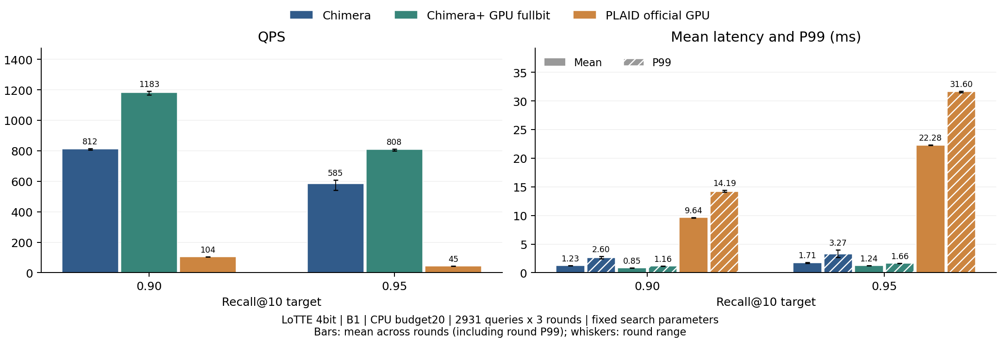
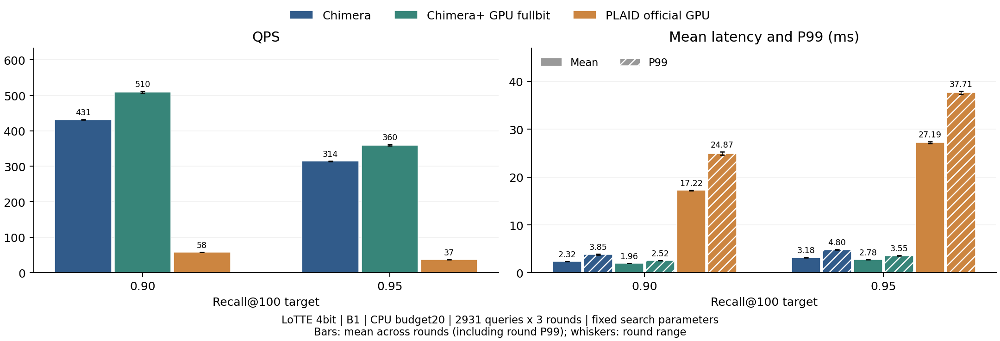
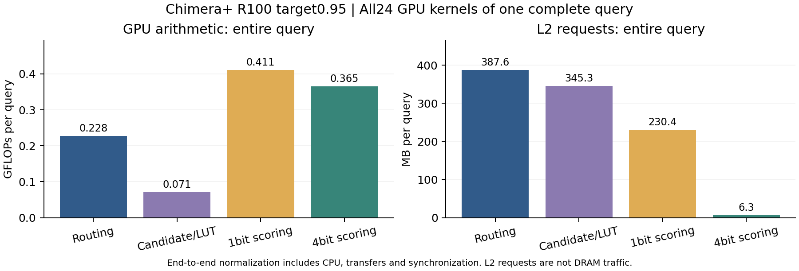
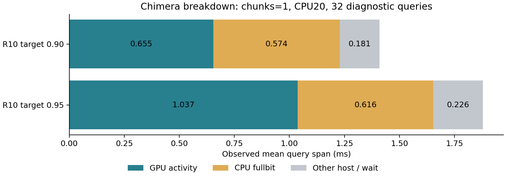
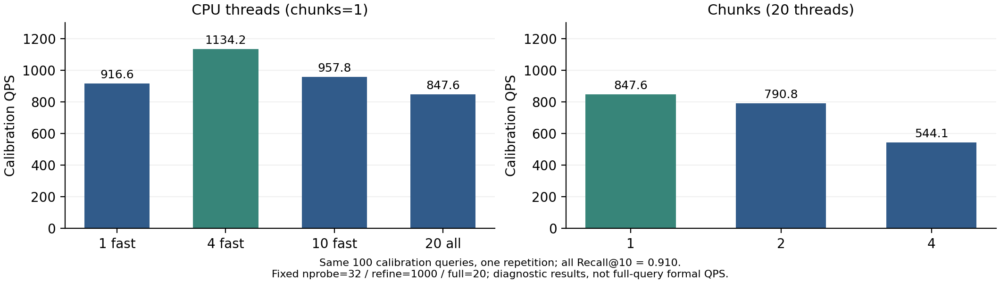
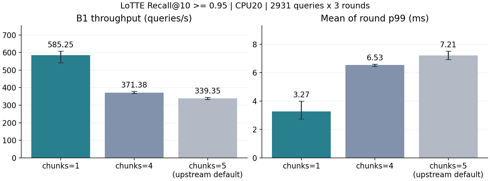

# LoTTE 实验报告

## 实验平台与设置


| 项目 | 设置 |
|---|---|
| 实验平台 | NVIDIA DGX Spark，GB10 GPU（sm_121）、20个ARM物理CPU核，128 GB LPDDR5X统一内存 |
| 数据集 | LoTTE pooled dev；2,428,854篇文档、2,931条查询 |
| 搜索设置 | 4bit索引，B1逐条搜索；分别实际返回Top-10和Top-100；召回目标0.90、0.95 |
| 正式测试 | 全部2,931条查询×3轮，每轮预热32条；主配置使用20线程 |
| 计时范围 | 预编码主机FP32查询→主机Top-k结果完成，包含查询上传；排除模型编码、索引加载、预热和写盘 |

| 对象 | 向量数量 | 每条向量维度 |
|---|---:|---:|
| 每条查询 | 固定 **32条** | 128维 |
| 每篇文档 | **3–180条**，平均 **109.6条** | 128维 |

全库文档合计 **266,205,513条向量**；2,931条查询合计 **93,792条向量**。


召回与QPS均统计全部2,931条查询，取三轮算术平均；无留出集。每轮QPS为查询数除以同步搜索总耗时。

PLAID统一采用官方GPU路径，调用原生`IndexScorer.rank`。

## Recall@10：端到端性能

**搜索参数（CPU预算20线程，B1）**

Chimera与Chimera+使用相同参数，顺序为`nprobe / k_refine / k_full_bit / CAGRA itopk / chunks`；PLAID为`ncells / ndocs / threshold`。

| 召回目标 | Chimera / Chimera+ | PLAID（官方GPU） |
|---:|---|---|
| 0.90 | 32 / 1000 / 20 / 64 / 1 | 1 / 1024 / 0.45 |
| 0.95 | 128 / 1000 / 50 / 160 / 1 | 4 / 4096 / 0.45 |

**同参替换精排后，Chimera+在0.90/0.95目标下的QPS分别为原Chimera的1.46/1.38倍。**

| 系统 | 目标R10 | 实际R10 | 平均QPS | 平均延迟ms | 各轮P99均值ms |
|---|---:|---:|---:|---:|---:|
| Chimera | 0.90 | 0.907870 | 811.80 | 1.232 | 2.604 |
| Chimera+ | 0.90 | 0.907824 | 1182.89 | 0.845 | 1.160 |
| PLAID（官方GPU） | 0.90 | 0.925316 | 103.74 | 9.639 | 14.186 |
| Chimera | 0.95 | 0.958649 | 585.25 | 1.714 | 3.265 |
| Chimera+ | 0.95 | 0.958581 | 807.56 | 1.238 | 1.660 |
| PLAID（官方GPU） | 0.95 | 0.956534 | 44.89 | 22.278 | 31.604 |



每点全2,931条查询×3轮，参数不重选。平均延迟、QPS及P99分别取三轮均值，误差线为三轮范围。原Chimera结果来自前批正式测试，Chimera+为本轮同参测试。

## Recall@100：端到端性能

**搜索参数（CPU预算20线程，B1）**

Chimera与Chimera+使用相同参数，顺序为`nprobe / k_refine / k_full_bit / CAGRA itopk / chunks`；PLAID为`ncells / ndocs / threshold`。

| 召回目标 | Chimera / Chimera+ | PLAID（官方GPU） |
|---:|---|---|
| 0.90 | 64 / 3000 / 300 / 96 / 1 | 2 / 4096 / 0.45 |
| 0.95 | 256 / 3000 / 300 / 288 / 1 | 4 / 8192 / 0.45 |

**Chimera+在0.90/0.95目标下的QPS分别为原Chimera的1.18/1.14倍。** 所有点均达标，搜索参数与原Chimera一致。

| 系统 | 目标R100 | 实际R100 | 平均QPS | 平均延迟ms | 各轮P99均值ms |
|---|---:|---:|---:|---:|---:|
| Chimera | 0.90 | 0.917085 | 431.16 | 2.319 | 3.847 |
| Chimera+ | 0.90 | 0.917033 | 509.81 | 1.962 | 2.521 |
| PLAID（官方GPU） | 0.90 | 0.921041 | 58.06 | 17.225 | 24.875 |
| Chimera | 0.95 | 0.952890 | 314.43 | 3.180 | 4.803 |
| Chimera+ | 0.95 | 0.952856 | 359.85 | 2.779 | 3.546 |
| PLAID（官方GPU） | 0.95 | 0.951648 | 36.78 | 27.188 | 37.710 |



## Chimera+：R100 0.95全流程GPU利用与带宽

固定`nprobe256 / refine3000 / full300 / itopk288 / chunks1`、CPU20。复用32条查询的正常轨迹，再对其中第一条完整查询采全部24次GPU kernel，覆盖路由、候选筛选、1bit评分、4bit精排。

**统计整个搜索调用，分母包含CPU、传输和同步，不再只看精排kernel。**

| 全流程指标 | 结果 | 统计方式 |
|---|---:|---|
| 正常端到端耗时 | 3.763 ms | 同一条查询的正常search计时，未用NCU replay耗时 |
| 全GPU kernel FP32运算量 | 1.075 GFLOP/查询 | 硬件指令计数，2×FFMA+FADD+FMUL |
| **端到端有效FP32吞吐** | **约0.286 TFLOP/s** | 全GPU运算量 ÷ 端到端时间，估算 |
| 全GPU kernel L2请求量 | 969.6 MB/查询 | 所有24次kernel的请求字节计数 |
| **端到端L2请求带宽** | **约257.7 GB/s** | 全L2请求量 ÷ 端到端时间，估算 |
| **下层内存读取请求带宽** | **约45.8 GB/s** | L2读取未命中扇区×32B ÷ 端到端时间，估算 |
| LPDDR实际读写总带宽 | 未直接取得 | 本机工具缺少DRAM计数 |

32条正常查询区间内，GPU活跃平均94.6%、SM活跃85.7%、SM指令发射14.1%。这些是全流程采样；上表吞吐是单条完整查询的计数估算，正式QPS仍使用前面的全量三轮结果。



**路由和候选阶段占据大量L2流量，只测精排会明显低估全流程。** GPU精排仅约6.3MB L2请求，而整条查询约969.6MB。

L2请求带宽不是LPDDR总线带宽。读取未命中估算未包含写回，且一致性缓存也可能响应请求，不能换算成DRAM利用率；[NVIDIA对32B扇区与L2未命中的说明](https://docs.nvidia.com/nsight-compute/ProfilingGuide/)和[计数不等于DRAM流量的说明](https://docs.nvidia.com/nsight-compute/ComputeTriage/)支持这一口径。

算术和内存计数分别来自两次短采集；都核对了24个kernel顺序，并与正常轨迹同一查询的Top-100 ID/FP32评分逐位一致。GPU拷贝、memset和CPU阶段的时间保留在端到端分母中，CPU算术与整数/位操作未计入GPU FP32 FLOPs。

<details>
<summary>全流程采集命令与原始计数</summary>

```sh
/usr/local/cuda/bin/ncu --target-processes all --profile-from-start off --launch-count 24 --cache-control none --disable-extra-suffixes --metrics gpu__time_duration.sum,lts__t_bytes.sum,smsp__sass_thread_inst_executed_op_ffma_pred_on.sum,smsp__sass_thread_inst_executed_op_fadd_pred_on.sum,smsp__sass_thread_inst_executed_op_fmul_pred_on.sum --force-overwrite --export /home/lxq/multi-query/systems/chimera-plus/profile-r100-p95/ncuflow/counters /home/lxq/graduate/.venv/bin/python /home/lxq/multi-query/systems/chimera/profile-v2/leaf_exec.py /home/lxq/multi-query/systems/chimera-plus/profile-r100-p95/ncuflow/tree-config.json
```

```sh
/usr/local/cuda/bin/ncu --target-processes all --profile-from-start off --launch-count 24 --cache-control none --disable-extra-suffixes --metrics gpu__time_duration.sum,lts__t_bytes.sum,lts__t_sectors_op_read_lookup_miss.sum,lts__t_sectors_aperture_sysmem_op_read_lookup_miss.sum,lts__t_sectors_op_write.sum --force-overwrite --export /home/lxq/multi-query/systems/chimera-plus/profile-r100-p95/memflow/counters /home/lxq/graduate/.venv/bin/python /home/lxq/multi-query/systems/chimera/profile-v2/leaf_exec.py /home/lxq/multi-query/systems/chimera-plus/profile-r100-p95/memflow/tree-config.json
```

```csv
GPU_stage,FP32_FLOPs,L2_requested_bytes,L2_read_miss_request_bytes_estimate
GPU route,227897856,387557856,62590976
GPU candidate/LUT,70609487,345259040,46481632
GPU 1bit scoring,411199496,230414528,63284320
GPU 4bit scoring,365138860,6327296,29792
```

[全24次kernel算术原始CSV](../systems/chimera-plus/profile-r100-p95/ncuflow/raw.csv) · [全24次kernel内存原始CSV](../systems/chimera-plus/profile-r100-p95/memflow/raw.csv) · [全流程汇总与公式](../systems/chimera-plus/profile-r100-p95/flow-summary.json)

</details>

## Chimera+：只替换完整4bit精排

[Chimera+单query流程图与kernel明细](chimera-plus.md)

**GPU直接读取现有4bit编码并计算MaxSim；路由、候选筛选、1bit评分及CPU最终Top-k不变。** GB10实际使用ATS主机页表访问已有编码/因子，没有复制第二份整库，也没有展开成FP32。

GPU保留CPU的FP32 FMA和归约顺序。104个合成候选、真实LoTTE四配置的22,780个候选评分（含预热）均与CPU逐位一致。正式计时关闭逐位复查，包含GPU精排、必要传输及完成同步。

项目Git仓库：`/home/lxq/multi-query`；源码位于`Chimera/`，分支`Chimera+`，GPU精排变更提交`c97f24c`。`baseline`分支保留原ARM实验源码历史。

## 原Chimera瓶颈分析：0.90与0.95

配置均使用CPU20、B1，参数顺序：`nprobe / refine / full / itopk / chunks`。

| 系统 / 放置 | R10目标0.90配置 | R10目标0.95配置 | 32条诊断轨迹 |
|---|---|---|---|
| Chimera | 32 / 1000 / 20 / 64 / 1 | 128 / 1000 / 50 / 160 / 1 | 两档均已采集；另测0.95 chunks4 |


### 阶段分解

以下为原Chimera的32条固定查询轨迹，单位ms/查询，均为chunks1；本轮未采集Chimera+阶段轨迹。

| 系统 / 放置 | R10目标 | 观测范围 | 总跨度ms/条 | GPU活动ms/条 | CPU完整4bit评分ms/条 | 重叠ms/条 | 其余区间ms/条 |
|---|---:|---|---:|---:|---:|---:|---:|
| Chimera | 0.90 | query | 1.409 | 0.655 | 0.574 | 0.000 | 0.181 |
| Chimera | 0.95 | query | 1.879 | 1.037 | 0.616 | 0.000 | 0.226 |




GPU活动包含kernel、copy、memset；其余区间包含主机整理、提交和等待。统计完整query范围，重叠为0。

- **Chimera：两档都存在CPU/GPU串行。** 0.95增大路由与精排规模后，GPU和CPU区域耗时均增加。
- **算力或带宽是否饱和：证据尚不足。** 当前明确的问题是执行组织与主机开销；缺有效DRAM带宽及CPU PMU计数。软件轨迹时间用于定位，正式性能看上节QPS。

## 原Chimera微调：chunks与CPU线程数

**结论：并行收益取决于任务粒度；当前小候选精排下，增加chunks或线程数会增加调度成本。**

### CPU线程与chunks：已有100条查询短测

固定`nprobe32 / refine1000 / full20 / itopk64`，同100条查询、各一次，所有Recall@10均为0.910。以下是诊断短测，未替代全量三轮结果。

| CPU线程 | 核集合 | chunks | QPS | 平均延迟ms |
|---:|---|---:|---:|---:|
| 1 | 7 | 1 | 916.55 | 1.091 |
| 4 | 5-8 | 1 | 1134.19 | 0.882 |
| 10 | 5-9,15-19 | 1 | 957.77 | 1.044 |
| 20 | 0-19 | 1 | 847.59 | 1.180 |
| 20 | 0-19 | 2 | 790.76 | 1.265 |
| 20 | 0-19 | 4 | 544.07 | 1.838 |



**CPU线程：4个快核短测最快，20线程反而下降。** CPU精排按文档分配任务，使用`OpenMP schedule(dynamic,1)`；此处full目标仅20篇，任务数少，增线程很快遇到并行度上限。更多线程增加任务领取、唤醒及结束屏障开销；文档长度不等还带来尾部等待。20核配置还包含不同性能的CPU核，因此线程数与核类型同时变化。源码支持这些机制，但短测没有分别隔离每项成本；不能据此判定“多核本身更慢”。

**chunks：20线程下，1→2→4的QPS持续下降。** 这组短测未记录实际精排量，下面用0.95的完整三轮和轨迹进一步解释。

### chunks：0.95全量三轮

**结论：保留chunks1，默认5更慢。** 参数固定为`128 / 1000 / 50 / 160`，仅改变chunks。

| chunks | 平均Recall@10 | 平均QPS | 三轮QPS范围 | 平均延迟ms | 各轮p99均值ms |
|---|---:|---:|---:|---:|---:|
| 1 | 0.958649 | **585.25** | 541.72–608.00 | 1.714 | 3.265 |
| 4 | 0.958581 | **371.38** | 367.05–379.49 | 2.693 | 6.534 |
| 5（上游默认） | 0.958592 | **339.35** | 332.62–344.66 | 2.947 | 7.206 |




| chunks | CPU精排文档/查询 | CPU区域ms/查询 | CPU/GPU重叠ms/查询 |
|---|---|---:|---:|
| 1 | 50篇，一次调用 | 0.616 | 0 |
| 4 | 12/13/12/13篇，四次调用 | 1.898 | 0.206 |


### 为什么开启流水线没有更快？

**流水线节省的重叠时间，小于切碎任务增加的时间。** 对本次32条诊断查询，chunks1→4时：

| 改变 | 每查询时间变化 |
|---|---:|
| CPU精排区域 | +1.281 ms |
| GPU活动 | +0.012 ms |
| 其余区间 | +0.022 ms |
| 新增CPU/GPU重叠 | −0.206 ms |
| 总查询跨度 | **+1.110 ms** |

两种设置实际都精排50篇；四块分别12/13/12/13篇，每块仍进入20线程OpenMP区域。GPU启动从23增至29次/query，CPU精排调用从1增至4次。事件同步次数增加，但wait_chunk总时间下降，变慢主要体现在CPU精排区域。

此外，chunks只让后续GPU文档评分与前一块CPU精排重叠；路由、候选生成和精炼不在这段流水线中。块数太多会缩小每块工作，并增加流水线启动、排空及调度成本。

**两种调参相互影响。** chunks越多，每次交给CPU的文档越少，越容易出现“线程多于任务”。更大的候选规模可能适合更多块或线程；主配置chunks采用全量三轮选出的1；CPU仍固定20以保持实验预算，将减少CPU小任务开销作为优化方向。4线程是否适合作为正式配置，需要同一目标下重新做全量三轮验证。

## UMA优化方向

| 方向 | 下一步 |
|---|---|
| CPU任务粒度 | 原Chimera可减少OpenMP小任务开销；Chimera+已移除CPU精排 |
| UMA数据访问 | Chimera+已用ATS直接读取4bit编码；候选/评分小缓冲区的传输仍可优化 |
| 事件复用 | 复用工作区事件，减少创建与销毁 |
| 跨查询协同 | 单独测试路由与前一查询CPU精排的流水线吞吐 |

原Chimera由CPU读取完整4bit编码；Chimera+已将这段评分迁到GPU。FP32展开仅用于构建，其他优化方向本轮未改。

## 数据证据

[Recall@10正式结果](lotte-r10-full-query-records.json) · [0.95选参与chunks明细](lotte-r10-95-chunks-data.json) · [0.90阶段数据](lotte-r10-nsys-stage-projection.json) · [0.95阶段数据](../systems/chimera/profile-v2/r10p95-overlap-v1/E-c1-c4-overlap-breakdown.json) · [Chimera R100结果](../systems/chimera/r100-v1/completion-summary.json) · [PLAID R100结果](../systems/plaid/ai-workspace/r100-native-device-lock-v2/final-acceptance.json) · [线程/chunks短测明细](../systems/chimera/fine-completion-v1/r10-controls-cal-v1/completion-summary.json)

[Chimera+四组正式结果与每轮数据](../systems/chimera-plus/formal-results.json) · [Chimera+源码与二进制身份](../systems/chimera-plus/implementation-identity.json)
