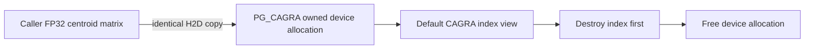

# Chimera construction checkpoint and owned-device centroid candidate

The current isolated candidate has compiled on Spark and passed 19 CPU checkpoint cases and 12 CPU supervision/identity cases. Its new owned-device GPU qualification awaits root review and authorization. `source/` contains the complete candidate; `chimera/arm-source`, the original binaries and original runners are unchanged.

## Dataset ownership correction

The preceding small GPU fixture found that native CAGRA host-view construction on Spark referenced the caller's centroid vector. The original final-graph build releases that vector before encoding/save. The candidate explicitly copies the same FP32 matrix to a `cudaMalloc` allocation and passes a device matrix view to the same default CAGRA parameters.



`explicit_dataset_` is declared before `index_cagra`, so member destruction releases the index first. Rebuilding and loading also reset the old index before releasing its backing allocation. Deserialized indexes retain cuVS's own dataset storage. The correction applies to the assignment and rotated final graphs. Input row order, centroid sample/rotation seeds42, default graph parameters, assignment batch65536, k1/itopk150, quantization, CPU scoring and CUDA search kernels are preserved.

The earlier borrowed-dataset candidate is archived in `borrowed-dataset-discovery/`. Its Q1 stop and same-live graph roundtrip receipts remain under `gpu-qualification/`, and its cache remains at its original data path. Those tests established the pointer alias discovery and serialization comparisons while the caller vector was alive; they do not qualify a final index. New candidate runs use `gpu-owned-device-qualification/` and fresh data cache/index names ending `owned-v2`.

## Optional checkpoint flow

Without checkpoint flags, the original sample/assign/rotate/encode/save sequence runs with the ownership correction. The optional checkpoint retains the sampled centroid matrix, the first default CAGRA graph and original assignment batches:

```
cache.identity.json   immutable input/binary/libraries/source/environment binding
cache/
  .lock               exclusive native cache writer
  state.txt           atomic V1 metadata + completed prefix + artifact digests
  centroids.f32       original sampled FP32 matrix
  assignment.cagra    first CAGRA graph and dataset, native serialization
  labels/<start>.u32  immutable original batches, per-chunk SHA256
```

`--build-checkpoint-dir DIR --build-checkpoint-identity-sha256 SHA` creates a cache. Existing caches require `--resume-build-checkpoint`. Configuration binds token count, dimension, clusters, bitwidth, fixed batch/k/itopk, both seeds and document-length-vector SHA. Resume verifies matrix/graph/chunks, exact byte lengths, contiguous batch boundaries and label ranges. Completion records the concatenated label SHA. Loaded graph size, dimension and default degree64 are checked.

Artifacts are flushed before atomic state publication. Initial cache creation fsyncs its parent before state commit. Uncommitted canonical files are retained as `orphan-*` hardlinks before regeneration. A failed initial commit requires a fresh cache.

`--stop-after-assignment-batches N` commits N new batches and returns exit3 before final index publication. Resume restores the committed prefix without searching those batches again. A stop on the final assignment batch returns3; the next resume completes the remaining original pipeline. Existing full-code spill behavior is reused.

## Identity and process supervision

`run_checkpoint_build.py --plan ...` creates no cache, hashes no raw data and launches no GPU. `--run` requires `UMA_RUN_GPU_TESTS=1` and coordinator authorization. The wrapper does not acquire another device lease.

Actual input, doclens, binary, resolved shared libraries, source manifest and optional extra identity files are hashed before launch. The pinned HF revision/URL and expected input digests are checked. Declared derivation receipt content is checked and tracked. CPU affinity, CUDA/OpenMP/library environment, wrapper, guard and supervision identities enter the immutable binding. Resume requires that exact binding.

The wrapper holds an output lock inherited by the exact GPU child. SIGTERM/SIGINT and exceptions terminate, escalate if needed and reap that child before releasing the lock. `exec_guard` installs checked-parent Linux PDEATHSIG(SIGKILL). Receipts record graceful failure/interruption; a hard parent death leaves the child holding the inherited lock until terminal. Existing output/spill paths are rejected.

Final metadata includes basic search identities and the qualified source4→derived8 adapter fields: actual `vector_input`, `input_mode=fp16_npy`, and `input_files.vector_input` path/device/inode/size/mtime/SHA. Checkpoint construction is labeled separately from fresh independent build time.

## CPU evidence and compilation

`compile.sh` builds the complete candidate with baseline cuVS/CUDA13/sm121, OpenSSL SHA256, CUDA devices masked and cores15–16/two jobs. `compile-owned-device.log` records the successful ABI-dependent recompilation and link. `source-manifest.json`, binary SHA and `validation.json` identify the candidate. `checkpoint-resume.patch` applies against the immutable original baseline.

`cpu-tests-owned-device.log` has 19 metadata tests: exact label resume, identity/config rejection, concurrent flock, missing/existing caches, corrupt/truncated matrix/graph/chunks, full SHA mutation, label ranges/boundaries, orphan preservation and intercepted real parent-directory fsync order. `cpu-supervision-tests-owned-device.log` has 12 CPU fake-child tests covering signals, escalation, exception cleanup, lock inheritance, hard parent death, normal exit3, binding directory fsync, declared derivation mutation and derived8 raw-stat metadata access.

`roundtrip-fixture/compile.sh` compiles two standalone qualification executables from the same candidate PG_CAGRA source. Compilation and CLI checks do not launch CUDA kernels.

## GPU acceptance sequence

All helpers use the fixed 10k-document, 1,087,049-token, D128 prefix, c8192; cores15–18, OMP4 and a bounded timeout ≤180s under the authorized offline cohort.

1. Fresh fixed4 and fixed8 original builds use the ownership-correct candidate and fresh output paths.
2. New Q1 stops after one assignment batch. Require exit3, exactly65536 committed labels and no published final index.
3. `checkpoint_graph_roundtrip` builds one live graph from the new cached matrix, verifies exact expected logical dataset SHA and device ownership, frees the caller vector and holds16 same-size overwrite allocations. Require unchanged dataset/graph. Compare first65536 and tail38473 k1/itopk150 labels and distance bits before/native save/load and original-live repeat. It also exercises repeated load and loading into the formerly build-owned object. Pointer attributes, strides and query-region diagnostics are recorded.
4. Clone the identical committed graph/prefix and binding into fresh branch caches. BranchA resumes fully; branchB stops after2 new batches and resumes fully. Require exact chunk/full labels and doclens/doc1bit/docfull payloads. Independently built final rotated CAGRA graph identities are retained.
5. `checkpoint_final_dataset` recomputes the seed42 FhtKac rotated cached centroid matrix and requires bit-exact logical dataset contents in the final saved `centroids.carga` after full encoding/save. This runs on fresh4/8 and A/B as scheduled.
6. ARM runs the original production engine's complete32-query diagnostic on A/B, including output/quality checks. The source4→derived8 per-row invariant is rechecked on fixed source.

`gpu-owned-device-freeze.json` freezes the executable/source/wrapper/helper identities after CPU preparation. Each launch records its actual PID, command, binding, timeout and terminal outcome. A failed gate is retained and reported before further continuation.
