# Full Chimera v2 execution preparation

Current templates: `templates-v3/catalog.json`. All commands in this directory are CPU-only; they never launch search. Frozen runner release: `64957121...`. Main candidate: algorithm Full `c54539...`; kernel candidate: `5e2ad9...`.

```mermaid
flowchart LR
 A[Actual index completed] --> B[Six payload SHA + rotated centroid audit + root acceptance]
 B --> C[Finalize exact query / GT / index identities]
 C --> D[Cal100 screening + candidate witness]
 D --> E[At most 3 distinct finalists per target]
 E --> F[Each finalist: 3 independent cal100 processes]
 F --> G[All 3 quality eligible; choose median QPS]
 G --> H[Freeze parameters and all raw receipt hashes]
 H --> I[Full queries × 3; full + heldout recall]
 I --> J[Keep passed / missing / heldout-failed ledger]
```

`plan.py generate --out NEW` writes templates. `finalize --template TEMPLATE --root-acceptance RECEIPT --out SPEC` requires a real completed index and an explicit root acceptance receipt. Its fields are `root_accepted:true`, exact `index`, six-name `payload_sha256`, `routing_sidecar_sha256`, `routing_dataset_audit_receipt`, `routing_dataset_audit_sha256`, and `build_provenance_sha256`. Derived8 also needs exactly the three approved fields under `derived_spec_fields`: `allow_derived_index`, `approved_requantize_tool_sha256`, `approved_requantize_qualification_sha256`. No audit is invented while an index is building. First CPU finalization reads each payload once and stores an acceptance-SHA-bound witness with device/inode/size/mtime/ctime. Later templates reuse that witness only while every field matches. A changed witness rejects. It publishes or verifies the identical artifact-manifest.json so the existing runner also reuses the accepted identity.

Run only in a separately authorized exclusive formal window using the existing `run_search_grid_v2.py`, then `accept_run_v2.py`. Primary configuration: B1, OMP20/all20 fast-first places, warmup32, host FP32 query upload through host IDs/scores completion. Full MS8 uses low-memory mmap/prefault, with pagefault review.

Stages are conditional, not one Cartesian grid: start with four cost/quality points; use paired ref40k/ref100k at full1k/full3k as candidate witnesses; expand full-bit budget if the target remains absent. Select local neighbors from cal100 if useful. Preserve every evaluated point and missing target. No-CR uses a positive `k_refine=1` CLI placeholder and processes the actual CG candidate set; no-IVF-PG and neither require the separately built coarse C131072 index.

`finalists --runs SCREEN_RUNS... --out NEW` emits three independent `rounds=1` specifications for at most three eligible points per target. Execute and independently accept them. `freeze-final --runs FINALIST_RUNS... --out NEW` checks strict v2 selection family, expected point sets, unique repetitions0/1/2, warmup32/non-profile mode, complete cal100 and accepted output contracts. A winner must meet the target in all three runs; median cal QPS chooses the winner. Every actual raw output/log/receipt hash is frozen. Formal output remains three separate rounds; the calibration median is only a selection statistic.

The freezer also writes calibration-only controls for CPU1/core7,4fast,10fast,20all and chunks1/2/4/6/8/10. Each control is a separate resource family; choose and freeze before heldout. Chunk comparisons must disclose actual accumulated full-bit work Khat from the observation trace.

`ledger --runs RUNS... --out FILE` retains all observed points, incomplete runs and per-target full/heldout failures. Heldout never drives a replacement configuration. Formal QPS, round mean/p95/p99 and interference acceptance come from final measurements, not the correctness or calibration receipts here.

`projection-validation.json` verifies both full datasets' cal100 GT and FP32 queries against the exact seed42 rows, all TSV IDs/ranks/local query IDs0..99, and the full MS manifest SHA. `CPU-validation.json` covers positive selection plus missing/duplicate repetitions, wrong mode/query/GT/binary/index/resource/load, profile/warmup and absent index acceptance rejection. Older templates-v1/v2 and fixtures are retained as preparation history; use v3.

Actual CPU path audit: `actual-finalize-validation.json` exercises the accepted real owned10k index, full six-file hash, second finalization with payload hashing prohibited, and changed-stat rejection. `pipeline-CPU-validation.json` runs the real runner preparation through screening → three finalist specs → freezer → both formal target specs, checking2931queries×3commands. Selection statistics in this fixture are synthetic, explicitly labeled; no search was run. `DERIVE8.md` and `prepare_derive.py` specify the future full CPU conversion; it remains unexecuted.
